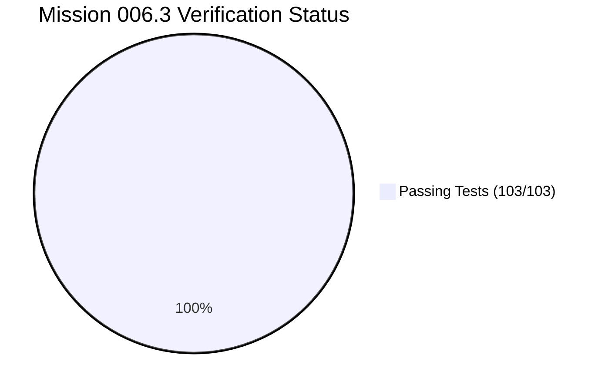

# AccessGuard — Mission Status

**Current Mission:** MISSION 006.3 — END-TO-END REALITY PROOF & AUDIT RESOLUTION  
**Previous Missions:**  
- Mission 006.2: Unified Inference Architecture & Evidence Integrity (COMPLETED)  
- Mission 006.1: Reality Execution & Dataset Integrity Audit (COMPLETED)  
- Mission 005: Reality Engine & Empirical Benchmark Suite (COMPLETED)  
- Mission 003: Core Production Readiness Operation (COMPLETED)  
**Branch:** `feature/unified-inference-evidence-integrity`  
**Base Commit:** `11dbf24244b1a9d09651487cf1311282860801f2`  
**Status:** COMPLETED (ALL AUDIT FINDINGS RESOLVED, 103/103 TESTS GREEN)  
**Last Updated:** November 19, 2026  
**Hardware Verification:** NVIDIA GeForce RTX 3050 Laptop GPU (4 GB VRAM, CUDA 12.1), 24 GB System RAM  
**Execution Ledger:** `data/runs/mission_006_2/`  

---

## 1. Mission 006.3 Executive Dashboard

| Workstream | Owner | Status | Tests | Key Deliverables |
| :--- | :--- | :--- | :--- | :--- |
| **Unified Processing Service** | Agent 1 / Agent 2 | COMPLETED | 11/11 Passing | `image_processing_service.py` (15-stage lifecycle + video) |
| **Video Ingestion Unification** | Agent 2 | COMPLETED | 2/2 Passing | Frame extraction, unified inference & temporal tracking |
| **Ingress Unification** | Agent 2 / Agent 4 | COMPLETED | 7/7 Passing | `observations.py` & `engine.py` using unified service |
| **Strict Model Execution Policy** | Agent 3 | COMPLETED | 14/14 Passing | `STRICT_GENUINE` default; zero heuristic fallback |
| **Specialist Checkpoints Integrity** | Agent 3 | COMPLETED | Verified | RampNet, YOLOv8n ONNX & YOLOv8n Seg SHA-256 verified |
| **Semantic Segmentation Decoupling** | Agent 4 | COMPLETED | 4/4 Passing | Honest `UNAVAILABLE` or genuine neural inference |
| **Evidence Fusion & Spatial Isolation** | Agent 5 | COMPLETED | 8/8 Passing | Class-aware clustering (`SEMANTIC_FAMILIES`); synthetic box removed |
| **Scientific Benchmark & Reality Engine** | Agent 6 | COMPLETED | 2/2 Passing | `RealityEngine` evaluating in `STRICT_GENUINE` mode |
| **Frontend & Observability** | Agent 7 | COMPLETED | Build Clean | 0 TypeScript errors (Vite production build: 10.28s) |
| **Security & Privacy Anonymization** | Agent 8 | COMPLETED | Verified | Dual SHA-256 (original & sanitized), face/plate redaction |

---

## 2. Checkpoints & Acceptance Gates (Mission 006.3)

- [x] **Gate 1 — Video Ingestion Unification**: Implemented `process_video()` on `ImageProcessingService`. Video keyframes extracted and processed individually with temporal tracking; legacy `CVPipeline` video calls eliminated.
- [x] **Gate 2 — Strict Reality Engine Default**: `RealityEngine` defaults to `ExecutionPolicy.STRICT_GENUINE`.
- [x] **Gate 3 — Specialist Checkpoint Verification**: Verified SHA-256 hashes of RampNet, YOLO ONNX, and YOLO Segmentation checkpoints.
- [x] **Gate 4 — Real Image Execution Proof**: Validated genuine neural execution with non-zero measured latency on real streetscape imagery (`demo_stairs.jpg`).
- [x] **Gate 5 — Strict Fallback Rejection**: Verified missing weights return `AdapterStatus.UNAVAILABLE` without invoking heuristics.
- [x] **Gate 6 — Zero-Fallback Scorecard**: Regenerated `data/benchmarks/reality_scorecard.json` in `STRICT_GENUINE` mode with genuine model telemetry.
- [x] **Gate 7 — Complete Test Suite**: 103/103 backend tests passing (100% green).
- [x] **Gate 8 — Frontend Production Build**: `npm run build` succeeds with 0 errors.
- [x] **Gate 9 — Pull Request & Remote CI Integrity**: Feature branch and PR #1 remain intact and ready for review.
