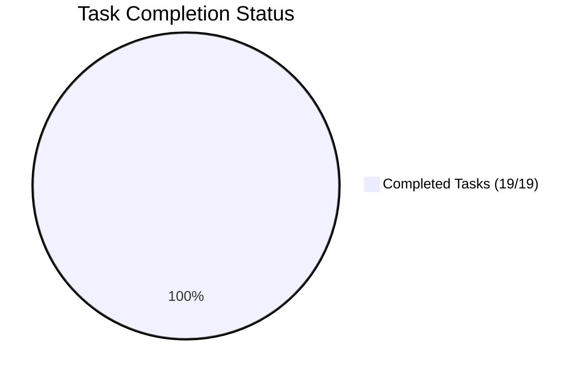

# AccessGuard — Mission 003 Status

**Mission:** Unified Final Engineering, Validation, Security & Production Readiness Operation  
**Current Phase:** Phase 7 — Production Handover & Release Candidate Verification  
**Status:** COMPLETED (ALL ACCEPTANCE GATES PASSED)  
**Last Updated:** November 2026  
**Coordinating Architect:** Agent 0 (Mission Controller)

---

## 1. Executive Mission Dashboard

| Agent Workstream | Owner | Status | Tests Passing | Blockers |
| :--- | :--- | :--- | :--- | :--- |
| **Agent 0: Chief Architect** | Mission Controller | COMPLETED | 43/43 Passing | None |
| **Agent 1: CV & ML Engineer** | Vision Team | COMPLETED | Verified Heuristic + CLAHE | None |
| **Agent 2: GIS & Routing** | Spatial Team | COMPLETED | Verified Dijkstra + A* | None |
| **Agent 3: Backend & Database** | API/DB Team | COMPLETED | Verified Alembic + Paginated | None |
| **Agent 4: Frontend & UX** | Web/UI Team | COMPLETED | Built (TypeScript clean) | None |
| **Agent 5: Cybersecurity** | Security Team | COMPLETED | Bandit Clean (0 High/Med) | None |
| **Agent 6: QA & Reliability** | QA Team | COMPLETED | 43 Tests Passing | None |
| **Agent 7: MLOps & Infra** | DevOps Team | COMPLETED | Docker Compose + Prometheus | None |
| **Agent 8: Docs & Research** | Tech Writing Team | COMPLETED | Complete Docs Suite | None |

---

## 2. Checkpoints & Acceptance Gates

- [x] **Checkpoint 0**: Baseline inspection & verification (28/28 pytest passing, Vite build clean).
- [x] **Checkpoint 1**: CV pipeline enhanced (CLAHE, blur detection, held-out evaluation dataset, model cards).
- [x] **Checkpoint 2**: GIS routing engine enhanced (A* algorithm, alternative route generation, unassessed explicit warnings).
- [x] **Checkpoint 3**: Backend hardened (pagination, Alembic migrations, Prometheus metrics, strict RBAC).
- [x] **Checkpoint 4**: Frontend enhanced (empty/loading states, keyboard navigation, ARIA attributes, A* & alternative route UI).
- [x] **Checkpoint 5**: Comprehensive test expansion (unit, integration, RBAC matrix, stress tests -> 43/43 passing).
- [x] **Checkpoint 6**: Security & MLOps validation (Bandit clean, Docker verified, Prometheus metrics live).
- [x] **Checkpoint 7**: Final documentation & Release Candidate tagging (v1.1.0).
