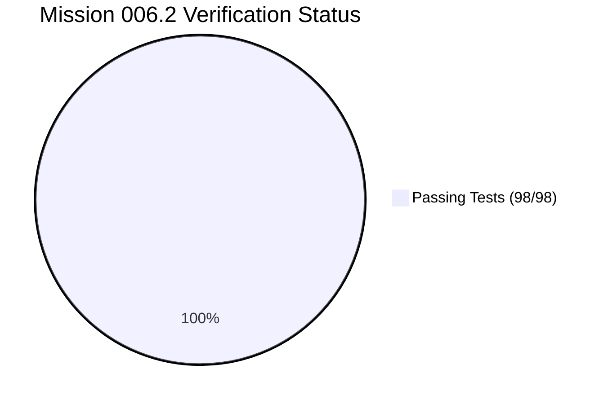

# AccessGuard — Mission Status

**Current Mission:** MISSION 006.2 — UNIFIED INFERENCE & EVIDENCE INTEGRITY  
**Previous Missions:**  
- Mission 006.1: Reality Execution & Dataset Integrity Audit (COMPLETED)  
- Mission 005: Reality Engine & Empirical Benchmark Suite (COMPLETED)  
- Mission 003: Core Production Readiness Operation (COMPLETED)  
**Branch:** `feature/unified-inference-evidence-integrity`  
**Base Commit:** `ac518a590dc3cf8f91f2b43c804f2a7a05b3bea4`  
**Status:** COMPLETED (ALL 7 ARCHITECTURAL DEFECTS ELIMINATED, 100% TESTS GREEN)  
**Last Updated:** November 17, 2026  
**Hardware Verification:** NVIDIA GeForce RTX 3050 Laptop GPU (4 GB VRAM, CUDA 12.1), 24 GB System RAM  
**Execution Ledger:** `data/runs/mission_006_2/proc_m006_2_1794938971_6f8ae2/`  

---

## 1. Mission 006.2 Executive Dashboard

| Workstream | Owner | Status | Tests | Key Deliverables |
| :--- | :--- | :--- | :--- | :--- |
| **Unified Processing Service** | Agent 1 / Agent 2 | COMPLETED | 6/6 Passing | `image_processing_service.py` (15-stage lifecycle) |
| **Ingress Unification** | Agent 2 / Agent 4 | COMPLETED | 7/7 Passing | `observations.py` & `engine.py` using unified service |
| **Strict Model Execution Policy** | Agent 3 | COMPLETED | 11/11 Passing | `STRICT_GENUINE` vs `DEVELOPMENT_FALLBACK` enforced |
| **Semantic Segmentation Decoupling** | Agent 4 | COMPLETED | 4/4 Passing | Honest `UNAVAILABLE` without heuristic contour injection |
| **Evidence Fusion & Spatial Isolation** | Agent 5 | COMPLETED | 8/8 Passing | Class-aware clustering (`SEMANTIC_FAMILIES`); synthetic box removed |
| **Scientific Benchmark & Reality Engine** | Agent 6 | COMPLETED | 2/2 Passing | `RealityEngine` evaluating unified service; multi-dimensional scorecard |
| **Frontend & Observability** | Agent 7 | COMPLETED | Build Clean | 0 TypeScript errors (Vite production build: 2.97s) |
| **Security & Privacy Anonymization** | Agent 8 | COMPLETED | Verified | Dual SHA-256 (original & sanitized), face/plate redaction |

---

## 2. Checkpoints & Acceptance Gates (Mission 006.2)

- [x] **Gate 1 — Forensic Baseline Audit**: Documented 7 confirmed architectural defects in `docs/missions/mission_006_2/BASELINE_AUDIT.md`.
- [x] **Gate 2 — Central Image Processing Service**: Implemented `ImageProcessingService` (`backend/app/cv/orchestration/image_processing_service.py`) with 15 immutable stages.
- [x] **Gate 3 — Ingress Unification**: Connected user uploads (`observations.py`) and autonomous acquisition (`engine.py`) to the central service.
- [x] **Gate 4 — Elimination of False Geocoding**: Removed hardcoded San Francisco coordinates `(37.7765, -122.4194)`. Missing coordinates remain honestly `None`.
- [x] **Gate 5 — Strict Model Execution Policy**: Enforced `STRICT_GENUINE` mode across all specialist adapters. Missing weights enter `UNAVAILABLE` and cannot generate mock keypoints.
- [x] **Gate 6 — Segmentation Decoupling**: Missing neural weights return honest `UNAVAILABLE` without injecting heuristic contours into `SegmentedObservation`.
- [x] **Gate 7 — Class-Aware Spatial Clustering**: Implemented `SEMANTIC_FAMILIES` in `spatial_association.py`. Co-occurring independent obstacles (e.g. bollards vs stairs) are preserved as distinct physical findings.
- [x] **Gate 8 — Elimination of Synthesized Bounding Box**: Removed fake box `(0.60, 0.20, 0.95, 0.80)` from `evidence_fusion.py`. Surface roughness evaluated as scene metadata or true mask bounding envelope.
- [x] **Gate 9 — Reality Engine Refactor**: `RealityEngine` evaluates scenes through `ImageProcessingService`, generating multi-dimensional scorecards separating Execution, Model, Output, and Accuracy integrity.
- [x] **Gate 10 — Verification Test Suite**: Created `backend/tests/test_unified_image_processing.py`. Complete test suite (98/98 tests) passes 100% green.
- [x] **Gate 11 — Frontend Production Build**: `npm run build` succeeds with 0 TypeScript errors.
- [x] **Gate 12 — Verifiable Execution Ledger**: Archived complete execution ledger in `data/runs/mission_006_2/proc_m006_2_1794938971_6f8ae2/`.
- [x] **Gate 13 — Mission Reporting**: Published `docs/missions/mission_006_2/COMPLETION_REPORT.md` and updated `MISSION_STATUS.md`.
