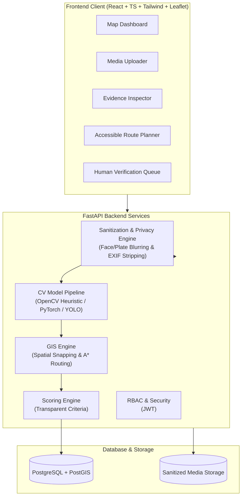

# AccessGuard 🛡️♿
> **Public-Benefit Accessibility Intelligence Platform**  
> Analyzing street-level imagery and short videos to map wheelchair accessibility barriers, maintain transparent sidewalk ratings, and navigate barrier-free routes.

[](https://github.com/Asterioxer/AccessGuard/actions)
[](LICENSE)
[](https://www.python.org/)
[](https://react.dev/)
[](https://www.docker.com/)

---

## 1. Project Overview

AccessGuard empowers wheelchair users, pedestrians with mobility aids, and municipal planners with verifiable, explainable accessibility data. By combining computer vision object detection and instance segmentation with GIS spatial processing, AccessGuard converts everyday street photos and videos into actionable pedestrian infrastructure intelligence.

### Key Capabilities

1. 📷 **Image & Short Video Ingestion**: Processes photos and videos with temporal keyframe clustering.
2. 🔍 **Accessibility Barrier Detection**: Identifies stairs, missing curb ramps, damaged footpaths, bollards, and construction obstacles.
3. 🔌 **Interchangeable Model Adapters**: Modular architecture supporting OpenCV heuristic vision, PyTorch Mask R-CNN, YOLO/ONNX, and benchmark adapters.
4. 📊 **Evidence & Uncertainty Calibration**: Explicit confidence metrics, uncertainty scores, and concrete physical evidence for every prediction.
5. 🗺️ **Geospatial Association**: Snaps visual observations onto pedestrian sidewalk networks with coordinate projection.
6. 🗄️ **PostGIS Geospatial Database**: Robust spatial storage and GeoJSON generation.
7. ⚖️ **Transparent Scoring Criteria**: Deterministic formulas evaluating sidewalk segment safety from 0 to 100 with itemized penalties and bonuses.
8. 🧭 **Interactive Map Dashboard**: High-contrast Leaflet map displaying colored segments, barrier badges, and inspection overlays.
9. 🤝 **Human-in-the-Loop Verification**: Peer consensus mechanism allowing community volunteers to verify or dispute AI flags.
10. ♿ **Wheelchair Route Recommendations**: Dijkstra/A* graph traversal navigating around stairs, steep slopes, and severe obstacles.

---

## 2. Architecture Diagram



---

## 3. Technology Stack

- **Frontend**: React 18, TypeScript, TailwindCSS, Leaflet, Lucide Icons, Vite.
- **Backend**: Python 3.12, FastAPI, SQLAlchemy ORM, Shapely, NetworkX, Pillow.
- **Computer Vision**: OpenCV (`cv2`), PyTorch, Torchvision, ONNX interface.
- **Database**: PostgreSQL 16 with PostGIS (with SQLite in-memory test compatibility).
- **Containerization**: Docker, Docker Compose, Multi-stage builds, Alpine Nginx.
- **Testing**: Pytest (28 automated tests covering all modules), Playwright E2E.
- **CI/CD**: GitHub Actions CI workflow.

---

## 4. Quickstart Guide

### Option A: Launch with Docker Compose (Single Command)
```bash
docker compose up -d --build
```
- Open Web UI: http://localhost:3000
- API Documentation: http://localhost:8000/docs
- Health Status: http://localhost:8000/health

Seed sample demo data:
```bash
docker compose exec backend python /app/scripts/seed_demo_data.py
```

### Option B: Local Development
#### 1. Backend:
```bash
# Set PYTHONPATH and run seed script
$env:PYTHONPATH="backend"
python scripts/seed_demo_data.py

# Launch FastAPI server
python -m uvicorn app.main:app --reload --port 8000
```

#### 2. Frontend:
```bash
cd frontend
npm install
npm run dev
```
Open http://localhost:5173 in your browser.

---

## 5. Automated Testing & Model Evaluation

Run the automated Pytest test suite:
```bash
$env:PYTHONPATH="backend"
python -m pytest backend/tests -v
```

Run the empirical CV benchmark evaluation runner:
```bash
$env:PYTHONPATH="backend"
python backend/app/cv/evaluation/run_eval.py
```

Build and typecheck the React application:
```bash
cd frontend
npm run build
```

---

## 6. Engineering Constraints & Ethical Safeguards

- **Zero Facial Recognition**: Pedestrian faces and vehicle license plates are blurred immediately upon ingestion using Gaussian redaction.
- **Metadata Scrubbing**: All GPS, altitude, and device identifiers in EXIF headers are purged prior to file storage.
- **No False Confirmation**: Obstacles are marked as `tentative` until backed by strong physical evidence ($> 85\%$ confidence) and peer consensus.
- **Explicit Uncertainty**: Borderline predictions are explicitly surfaced to prevent misleading wheelchair users.
- **Clean Room Open Source**: Developed without proprietary code, datasets, or credentials.

---

## 7. Documentation Index

- [Architecture Blueprint](docs/architecture.md)
- [Database Schema & PostGIS Models](docs/database_schema.md)
- [REST API Documentation](docs/api_documentation.md)
- [Model Evaluation Framework & Benchmark Results](docs/model_evaluation.md)
- [Security Assessment & Threat Model (STRIDE)](docs/security_assessment.md)
- [Deployment Instructions](docs/deployment.md)
- [Demonstration Walkthrough](docs/demonstration.md)
