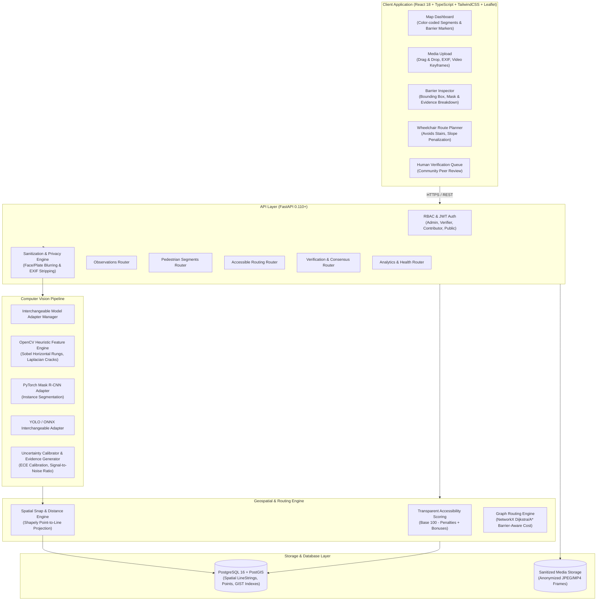
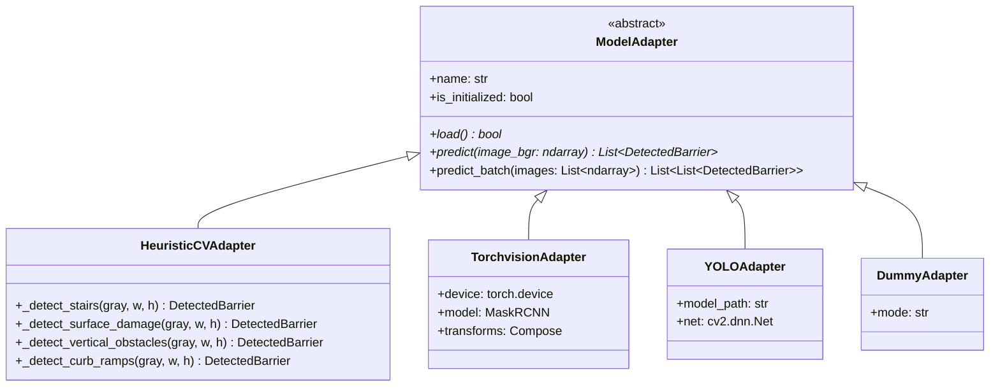

# AccessGuard System Architecture

## 1. Executive Summary

AccessGuard is an open-source, public-benefit accessibility intelligence platform that analyzes street-level images and short videos to detect wheelchair accessibility barriers, maintain a verifiable geospatial record, score individual sidewalk segments, and recommend barrier-free pedestrian routes.

---

## 2. High-Level System Architecture

---

## 3. Component Deep Dive

### 3.1. Computer Vision Pipeline

AccessGuard enforces strict interchangeability across vision backends through the `ModelAdapter` abstract interface:

#### Uncertainty Calibration & Evidence Extraction
- **Edge Rung Analysis**: Stairs are identified by clustering horizontal gradient rungs using Sobel filters and Hough line transforms. The step count, regular vertical spacing, and contrast standard deviation are recorded as deterministic evidence.
- **Surface Fracture Roughness**: Cracked or degraded asphalt/concrete is measured via high-frequency edge density and Laplacian variance in the pedestrian corridor region.
- **Explicit Uncertainty**: Borderline detections with confidence $< 0.70$ or signal ambiguity $> 0.35$ are tagged with `is_uncertain = true`. No barrier is marked as `is_confirmed = true` without exceeding $0.85$ confidence AND human consensus.

### 3.2. GIS Spatial Indexing & Snapping

- Pedestrian sidewalks and crosswalks are represented as `LineString` geometries in WGS84 coordinates.
- Incoming GPS coordinates (from EXIF or manual user geotagging) are projected onto candidate street segments using geodesic projection.
- Observations within the $25.0\text{ m}$ snap tolerance are linked to the segment foreign key (`segment_id`).

### 3.3. Transparent Accessibility Scoring Algorithm

Segment accessibility is calculated deterministically with full mathematical transparency:

$$\text{Net Score} = \max\left(0.0, \min\left(100.0, 100.0 - \sum \text{Penalties} + \sum \text{Bonuses}\right)\right)$$

| Barrier Type | Raw Impact | Justification |
| :--- | :--- | :--- |
| **Stairs (Unramped)** | -45 pts | Complete vertical obstruction for manual wheelchairs. |
| **Missing Curb Ramp** | -35 pts | Impassable street crossing drop-off. |
| **Steep Incline** | -30 pts | Exceeds ADA maximum grade ($> 8.3\%$). |
| **Construction / Narrow Path** | -25 pts | Corridor width constriction $< 90\text{ cm}$. |
| **Surface Damage / Potholes** | -20 pts | Caster wheel trap / tip-over hazard. |
| **Accessible Curb Ramp** | +15 pts | Compliant flared ADA transition. |

**Weighting by Verification Status:**
- `verified` (multi-peer confirmed): $1.0\times$ weight
- `tentative` (unreviewed machine flag): $0.5\times$ weight
- `disputed` / `rejected`: $0.0\times$ weight

---

## 4. Multi-Agent Responsibilities

To ensure separation of concerns and robust verification, AccessGuard is organized into dedicated architectural sub-disciplines:

1. **System Architecture Agent**: Defines interfaces, directory contracts, and configuration schemas.
2. **CV Model Pipeline Agent**: Implements model adapters, video frame samplers, and evidence extraction.
3. **Backend & Database Agent**: Enforces PostGIS schemas, CRUD operations, and async media handlers.
4. **GIS Processing Agent**: Manages spatial indexing, snapping, transparent scoring, and graph A* routing.
5. **Frontend & Maps Agent**: Builds interactive Leaflet visualization, route planning controls, and peer review queues.
6. **Security & Threat Modeling Agent**: Audits upload validation, enforces RBAC, strips EXIF, and prevents facial recognition.
7. **QA & Integration Agent**: Develops test fixtures, validates mAP and ECE benchmarks, and configures CI workflows.
