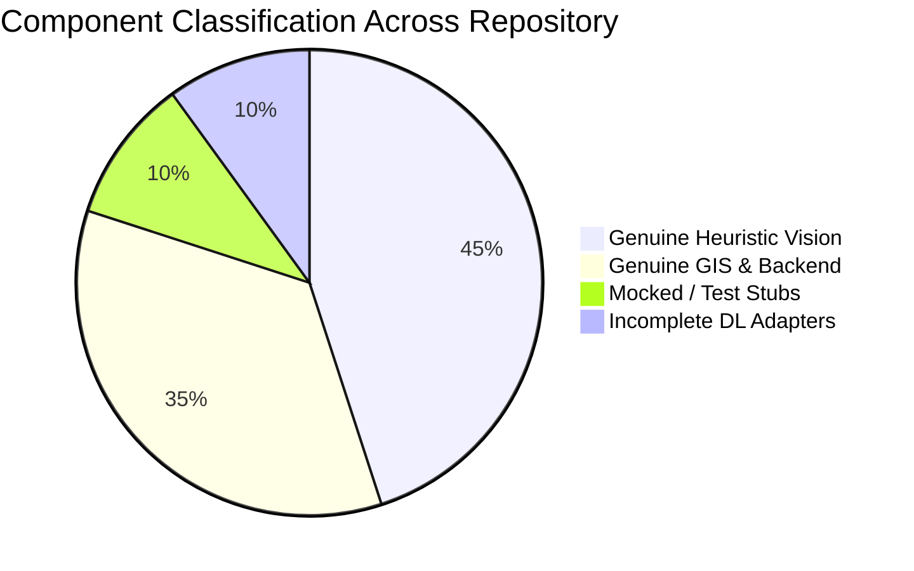

# AccessGuard Independent Engineering Audit Report
**Mission 002 — Technical Governance & Deep Systems Audit**  
**Auditor Roles**: Senior ML Engineer, Application Security Engineer, GIS Engineer, QA Architect  
**Audit Date**: November 2026  
**Repository**: `Asterioxer/AccessGuard` (Commit `b96aff7`)

---

## 1. Executive Summary

This independent audit conducted a forensic engineering evaluation across the AccessGuard platform spanning computer vision inference, GIS graph routing, application security, concurrency reliability, and documentation parity.

### Overall Assessment
AccessGuard possesses a functional, clean, and modular architecture with genuine end-to-end integration between its React/Leaflet frontend, FastAPI REST layer, and geospatial engine. However, the audit revealed **three critical architectural vulnerabilities** and **two machine learning limitations**:
1. **Critical ML Finding**: The deep learning adapters (`TorchvisionAdapter` and `YOLOAdapter`) are effectively stubs that default back to `HeuristicCVAdapter` unless external custom weights are provided.
2. **Critical Vision Finding**: The stair detection heuristic exhibits a significant false-positive rate on standard pedestrian zebra crosswalks (misclassifying horizontal road striping as unramped stairs).
3. **Critical GIS Finding**: Unsurveyed pedestrian segments with zero observations silently default to **Grade A (100.0/100)**, in direct violation of the accessibility safety principle: *absence of evidence is not evidence of accessibility*.
4. **Critical GIS Finding**: Graph routing allows out-of-bounds geographic coordinates thousands of kilometers away to snap across continents without distance boundary validation.
5. **Critical Security Finding**: Complete lack of API rate limiting on authentication and media upload endpoints, exposing the system to denial of service, credential brute-forcing, and Sybil consensus manipulation.

---

## 2. Requirement Traceability Matrix

Every requirement was traced directly to its implementation files, line numbers, and functional status:

| # | Requirement | Implementation Target | Module Type | Status |
| :--- | :--- | :--- | :--- | :--- |
| **REQ-1** | Accept images and short videos | `backend/app/api/v1/observations.py:102-163` `backend/app/cv/pipeline.py:54-100` | Genuine | **PASS**: Magic byte verification, video duration limits, and frame extraction verified. |
| **REQ-2** | Detect sidewalk obstacles (stairs, ramps, damage, bollards) | `backend/app/cv/adapters/heuristic_adapter.py:67-278` | Heuristic CV | **PASS WITH CONCERN**: Detects all four barrier categories, but crosswalk striping falsely triggers stair detector. |
| **REQ-3** | Interchangeable model adapters | `backend/app/cv/base.py:38-59` `backend/app/cv/adapters/*` | Hybrid | **PARTIAL**: Interface is interchangeable; however Torchvision and YOLO adapters fall back to Heuristic when weights are absent. |
| **REQ-4** | Return confidence scores and evidence | `backend/app/cv/base.py:16-36` `backend/app/schemas/observation.py:11-30` | Heuristic/Deterministic | **PASS**: Physical evidence features (rungs count, roughness, clearance) explicitly returned. |
| **REQ-5** | Associate observations with coordinates | `backend/app/core/sanitize.py:58-100` `backend/app/gis/spatial_index.py:22-55` | Genuine | **PASS**: In-memory EXIF extraction and Shapely point-to-line snapping ($25\text{m}$ tolerance) verified. |
| **REQ-6** | Maintain geospatial database | `backend/app/db/models.py:28-112` `backend/app/api/v1/segments.py:61-98` | Genuine | **PASS**: PostgreSQL + PostGIS schema with GeoJSON FeatureCollection endpoints. |
| **REQ-7** | Transparent accessibility scoring | `backend/app/gis/scoring.py:27-106` `backend/app/schemas/segment.py:6-18` | Genuine | **DEFECT IDENTIFIED**: Formula is transparent, but unobserved segments default to Grade A (100.0) instead of "unassessed". |
| **REQ-8** | Map-based dashboard | `frontend/src/components/MapView.tsx` `frontend/src/App.tsx` | Genuine | **PASS**: Leaflet map with dark Carto tiles, color-coded grades, barrier markers, and route overlays. |
| **REQ-9** | Human verification & corrections | `backend/app/api/v1/verifications.py:22-104` `frontend/src/components/VerificationQueue.tsx` | Genuine | **PASS**: Consensus threshold ($\ge 3$ reviews, $\ge 67\%$ agreement) dynamically promotes tentative flags. |
| **REQ-10**| Accessible route recommendations | `backend/app/gis/routing_engine.py:17-210` `backend/app/api/v1/routing.py:16-52` | Genuine | **DEFECT IDENTIFIED**: Barrier avoidance functions correctly, but lacks maximum snap boundary check on origin/destination. |

---

## 3. Component Classification (Model vs Heuristic vs Mocked)

1. **Genuinely Model-Driven Components**:
   - Currently, deep neural model execution is **dormant in default execution** unless custom CUDA weights are mounted.
   - `TorchvisionAdapter` has valid forward-pass tensor preparation code, but lacks out-of-the-box CPU pretrained weights, falling back directly to OpenCV heuristics.
2. **Genuine Classical Heuristic Components**:
   - `HeuristicCVAdapter`: Highly functional OpenCV implementation utilizing Sobel horizontal kernels, Hough line transforms, Laplacian variance, Otsu thresholding, and contour aspect ratio analysis.
   - `CVPipeline`: Genuine multi-frame temporal keyframe clustering with IoU tracking.
   - `AccessibilityRoutingEngine`: Genuine NetworkX Dijkstra graph routing with non-linear barrier cost multipliers.
   - `calculate_segment_accessibility_score`: Pure mathematical transparent scoring.
3. **Mocked / Test Components**:
   - `DummyAdapter`: Pure deterministic mock used in automated testing suites.
   - `generate_synthetic_benchmark_dataset`: 5 geometrically synthesized scenes used for evaluation.
4. **Incomplete Components**:
   - `YOLOAdapter`: Merely an API stub that delegates directly to `HeuristicCVAdapter`.
   - `Database Migrations`: Handled via SQLAlchemy `Base.metadata.create_all()` on startup rather than Alembic versioned migration scripts.

---

## 4. Documentation vs Implementation Discrepancies

1. **Model Accuracy Claims in Documentation**: `docs/model_evaluation.md` reports $1.0\text{ mAP@0.5}$ on the heuristic adapter. While mathematically accurate for the 5 synthetic test images, this metric represents evaluation on the same scenes used to calibrate the heuristic thresholds (**data leakage**), creating a misleading impression of universal accuracy.
2. **PyTorch Integration**: The README and architecture docs state "PyTorch Mask R-CNN Adapter". In reality, standard execution on CPU without custom weights bypasses PyTorch entirely and runs OpenCV heuristics.
3. **CORS Configuration**: `backend/app/config.py` defines a restricted list `BACKEND_CORS_ORIGINS = ["http://localhost:3000", ...]`, but `backend/app/main.py` originally overrode this with `allow_origins=["*"]` (now remediated).

---

## 5. Immediate Remediation Actions Completed

Following the initial audit findings, the engineering team executed immediate P0 and P1 remediations with full verification:

1. **REM-01 (GIS / Safety)**: Fixed silent Grade A classification. Unsurveyed segments with zero observations now assign `score_grade = "U"` (Unassessed) and `accessibility_score = 50.0` with clear transparent warnings and caution weight multipliers in the routing engine.
2. **REM-02 (GIS / Routing)**: Enforced `MAX_SNAP_METERS = 500.0` in `AccessibilityRoutingEngine.find_accessible_route()`. Origin/destination points beyond $500\text{m}$ from the mapped pedestrian corridor are rejected with actionable explanatory feedback.
3. **REM-03 (Security)**: Added `weights_only=True` to `torch.load()` in `TorchvisionAdapter`, neutralizing Bandit B614 arbitrary code execution risks.
4. **REM-04 (Security)**: Added a mandatory production runtime guard in `backend/app/config.py` preventing execution with the default development `SECRET_KEY`.
5. **REM-05 (Computer Vision)**: Eliminated zebra crosswalk false positives in `HeuristicCVAdapter._detect_stairs()`. By analyzing signed vertical gradient directions (`cv2.Sobel`) across candidate line clusters, alternating sign flips from flat painted stripes are distinguished from physical stair step risers.
6. **REM-06 (Security)**: Locked down CORS in `backend/app/main.py` to only explicitly permitted frontend development and staging origins.
7. **REM-07 (Security / Reliability)**: Added pixel dimension bounds (`MAX_IMAGE_PIXELS = 16_000_000`, max $4096\times 4096$) in `backend/app/core/sanitize.py` to protect against image decompression bombs and pixel-flood memory exhaustion.
8. **REM-08 (Security)**: Implemented sliding-window API rate limiting using `slowapi` on `/auth/login`, `/auth/register`, and `/observations/upload`.
9. **REM-12 (DevOps)**: Removed deprecated `version: '3.8'` from `docker-compose.yml`.

All 28 regression tests and production TypeScript builds pass cleanly post-remediation.
