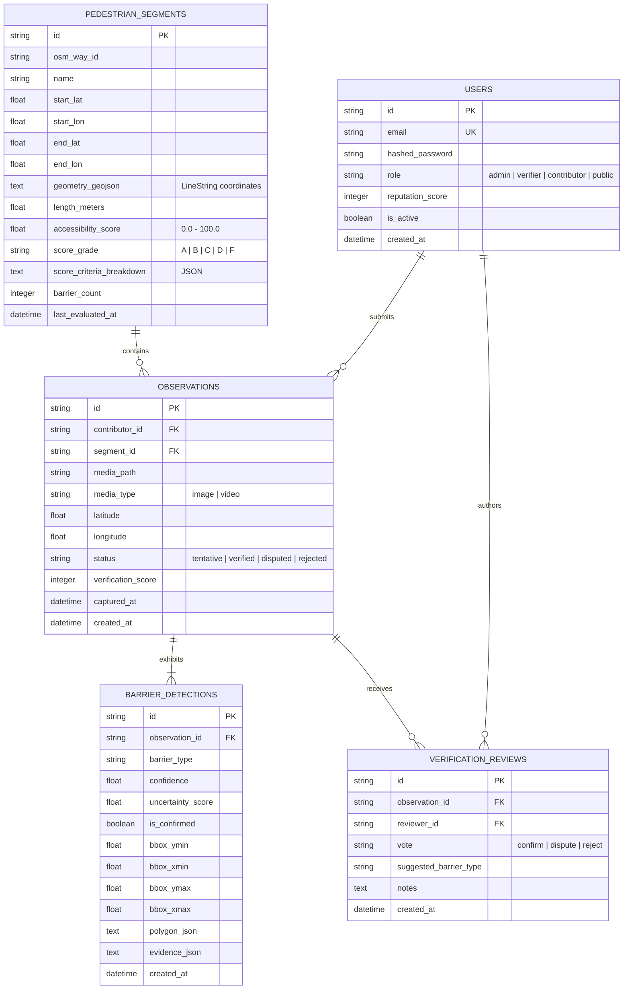

# AccessGuard Database Schema & Geospatial Architecture

## 1. Entity-Relationship Diagram

---

## 2. Table Specifications & Data Dictionaries

### 2.1. `users`
| Column | Type | Nullable | Constraints / Description |
| :--- | :--- | :--- | :--- |
| `id` | `VARCHAR(36)` | No | Primary Key (UUID v4) |
| `email` | `VARCHAR(255)`| No | Unique, B-Tree Index |
| `hashed_password` | `VARCHAR(255)`| No | Bcrypt (12 rounds) salted hash |
| `role` | `VARCHAR(32)` | No | Default `'contributor'`. Enum: `admin`, `verifier`, `contributor`, `public` |
| `reputation_score`| `INTEGER` | No | Default `10`. Increases with verified contributions |
| `is_active` | `BOOLEAN` | No | Default `TRUE` |
| `created_at` | `TIMESTAMP` | No | UTC creation timestamp |

### 2.2. `pedestrian_segments`
| Column | Type | Nullable | Description |
| :--- | :--- | :--- | :--- |
| `id` | `VARCHAR(36)` | No | Primary Key (UUID v4 or OSM ID) |
| `osm_way_id` | `VARCHAR(64)` | Yes | OpenStreetMap way identifier |
| `name` | `VARCHAR(255)`| No | Sidewalk corridor or crosswalk name |
| `start_lat`, `start_lon` | `FLOAT` | No | Start vertex in WGS84 decimal degrees |
| `end_lat`, `end_lon` | `FLOAT` | No | End vertex in WGS84 decimal degrees |
| `geometry_geojson` | `TEXT` | No | GeoJSON LineString coordinates `[[lon, lat], ...]` |
| `length_meters` | `FLOAT` | No | Geodesic length along polyline |
| `accessibility_score`| `FLOAT` | No | Transparent score between $0.0$ and $100.0$ |
| `score_grade` | `VARCHAR(2)` | No | Grade badge (`A`, `B`, `C`, `D`, `F`) |
| `score_criteria_breakdown` | `TEXT` | No | JSON serialization of penalties and bonuses |
| `barrier_count` | `INTEGER` | No | Total obstacles mapped on this segment |
| `last_evaluated_at` | `TIMESTAMP` | No | UTC timestamp of last dynamic scoring |

### 2.3. `observations`
| Column | Type | Nullable | Description |
| :--- | :--- | :--- | :--- |
| `id` | `VARCHAR(36)` | No | Primary Key (UUID v4) |
| `contributor_id`| `VARCHAR(36)` | Yes | Foreign Key -> `users.id` (Nullable for guest uploads) |
| `segment_id` | `VARCHAR(36)` | Yes | Foreign Key -> `pedestrian_segments.id` (Snapped) |
| `media_path` | `VARCHAR(512)`| No | Path to sanitized, privacy-redacted image or video |
| `media_type` | `VARCHAR(16)` | No | `'image'` or `'video'` |
| `latitude` | `FLOAT` | Yes | Decimal latitude in WGS84 |
| `longitude` | `FLOAT` | Yes | Decimal longitude in WGS84 |
| `status` | `VARCHAR(16)` | No | `'tentative'`, `'verified'`, `'disputed'`, `'rejected'` |
| `verification_score` | `INTEGER`| No | Net consensus score ($\text{confirm} - \text{disputes}$) |
| `captured_at` | `TIMESTAMP` | Yes | Media capture time (extracted from EXIF prior to purge) |
| `created_at` | `TIMESTAMP` | No | UTC submission timestamp |

### 2.4. `barrier_detections`
| Column | Type | Nullable | Description |
| :--- | :--- | :--- | :--- |
| `id` | `VARCHAR(36)` | No | Primary Key (UUID v4) |
| `observation_id` | `VARCHAR(36)`| No | Foreign Key -> `observations.id` |
| `barrier_type` | `VARCHAR(64)` | No | `stairs`, `curb_ramp_missing`, `curb_ramp_present`, `surface_damage`, etc. |
| `confidence` | `FLOAT` | No | Model confidence score ($0.0 - 1.0$) |
| `uncertainty_score` | `FLOAT` | No | Explicit uncertainty estimate ($0.0 - 1.0$) |
| `is_confirmed` | `BOOLEAN` | No | True only if confidence $\ge 0.85$ and uncertainty $\le 0.20$ |
| `bbox_ymin`..`bbox_xmax` | `FLOAT` | No | Normalized bounding coordinates $[0.0, 1.0]$ |
| `polygon_json` | `TEXT` | Yes | JSON polygon mask vertices `[[x, y], ...]` |
| `evidence_json` | `TEXT` | No | Measurable physical evidence (rungs, edge density, clearance) |

### 2.5. `verification_reviews`
| Column | Type | Nullable | Description |
| :--- | :--- | :--- | :--- |
| `id` | `VARCHAR(36)` | No | Primary Key (UUID v4) |
| `observation_id` | `VARCHAR(36)`| No | Foreign Key -> `observations.id` |
| `reviewer_id` | `VARCHAR(36)` | No | Foreign Key -> `users.id` |
| `vote` | `VARCHAR(16)` | No | `'confirm'`, `'dispute'`, `'reject'` |
| `suggested_barrier_type` | `VARCHAR(64)` | Yes | Optional correction if misclassified |
| `notes` | `TEXT` | Yes | Reviewer notes and ground-truth observations |
| `created_at` | `TIMESTAMP` | No | UTC vote submission timestamp |
