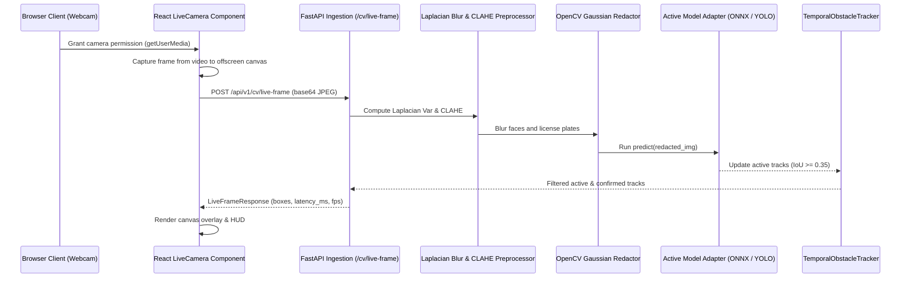

# Live Camera Intelligence, Temporal Deduplication & Benchmarking Guide

AccessGuard Release 1.2.0 introduces real-time camera inference, temporal tracking to eliminate duplicate obstacle reporting, and independent benchmarking across academic datasets.

---

## 1. Live Camera Architecture

---

## 2. Temporal Deduplication & Tracking Engine

### Problem:
When streaming camera video at 30 FPS, an ambulatory pedestrian or wheelchair user looking at a single 4-step staircase generates up to 90 identical frames in 3 seconds. Treating each frame as an independent observation spams the database and skews municipal accessibility scores.

### Solution:
The `TemporalObstacleTracker` (`backend/app/cv/temporal_tracker.py`) matches bounding boxes across consecutive frames using:
1. **Spatial IoU Threshold:** $\text{IoU}(B_{\text{new}}, B_{\text{track}}) \ge 0.35$.
2. **Category Consistency:** Requires matching `barrier_type`.
3. **Temporal Staleness Window:** Drops tracks inactive for $\Delta t > 3.0\text{ seconds}$.
4. **Promotion Threshold:** An obstacle is promoted to `is_confirmed = True` only after persisting across $\ge 3$ consecutive frames with confidence $\ge 0.70$.

---

## 3. Hugging Face Dataset Ingestion & Normalization

The dataset pipeline (`backend/app/cv/datasets/`):
- **Streaming Mode:** Uses `load_dataset(name, streaming=True)` to stream samples without filling local hard drives.
- **Storage Safety Check:** Validates available disk space (`check_storage_safety()`) before persisting slices.
- **Strict Semantic Separation:** Roadway cracks (e.g. SVRDD `D00`, `D10`, `D20`) are classified as `unknown_infrastructure` unless verified on pedestrian sidewalks with wheelchair traversal impact.
- **Unified Schema:** All source formats (YOLO normalized, COCO pixels, Pascal VOC) normalize to $[ymin, xmin, ymax, xmax]$ in $[0.0, 1.0]$.
