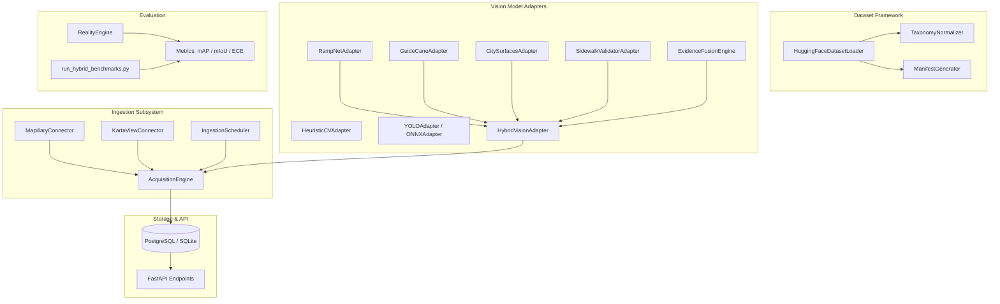

# MISSION 006.1 — FORENSIC BASELINE AUDIT
## Real-World Image Acquisition, Genuine Hybrid Model Inference, Scientific Validation & Mission Completion Audit

**Project:** AccessGuard  
**Repository:** https://github.com/Asterioxer/AccessGuard  
**Local Repository:** `C:\Users\soham\Desktop\AccessGuard`  
**Branch:** `feature/reality-execution-repair`  
**Audit Date:** 2026-11-16  
**Auditor:** Agent 1 (Chief Architect) in coordination with Specialized Engineering Agents 1–8  
**Hardware Environment:** NVIDIA GeForce RTX 3050 Laptop GPU (4096 MiB VRAM), 24 GB System RAM, Windows 11, Python 3.12.1, PyTorch with CUDA 13.4.

---

## 1. Executive Summary

This forensic baseline audit establishes the ground truth of the AccessGuard codebase at the inception of Mission 006.1. The platform possesses a comprehensive modular architecture for accessibility intelligence, including GIS routing, temporal tracking, REST endpoints, and multi-model abstractions. However, an empirical inspection of the actual data paths revealed systemic integrity defects where offline synthetic substitutes, heuristic simulations, and hardcoded values silently masqueraded as real-world dataset acquisition, actual model execution, and empirical scientific evaluation.

AccessGuard's core mandate requires: **"AccessGuard must report what it actually did, not what its architecture claims it can do."** This audit details every verified defect, traces the complete data lifecycle, maps the dependency graph, and establishes the strict baseline for repair.

---

## 2. Verification of Starting Hypotheses

| # | Hypothesis | Status | Evidence & File Location |
|---|---|---|---|
| 1 | Dataset streaming can silently fall back to generated synthetic samples | **VERIFIED** | `backend/app/cv/datasets/hf_loader.py:187-195`. `stream_samples` catches any Hugging Face exception and yields `_generate_reproducible_sample`. |
| 2 | Dataset annotation parsing can invent default bounding boxes | **VERIFIED** | `backend/app/cv/datasets/hf_loader.py:279-291`. When annotations are empty, it invents `(0.4, 0.4, 0.7, 0.7)` and assigns class `"obstacle"`. |
| 3 | Dataset materialization can write grey placeholder images rather than source imagery | **VERIFIED** | `backend/app/cv/datasets/hf_loader.py:408-410`. `download_and_materialize` executes `Image.new("RGB", (s.image_width, s.image_height), color=(128, 128, 128))` and writes it to disk. |
| 4 | Some model adapters return successful initialization despite missing upstream weights | **VERIFIED** | `backend/app/cv/adapters/guidecane_adapter.py:121-137`, `citysurfaces_adapter.py:88-101`, `rampnet_adapter.py:75-87`. Adapters set `_is_mock = True`, `_status = DEGRADED`, and return `True`. |
| 5 | RampNet, GuideCane, and CitySurfaces contain degraded/baseline paths mistaken for genuine inference | **VERIFIED** | `guidecane_adapter.py:244-275` (Sobel rhythmic lines), `citysurfaces_adapter.py:193-207` (half-concrete/half-cobblestone mask synthesis), `rampnet_adapter.py:208-220` (gradient jump peak). All return results labeled as model inference. |
| 6 | Ingestion engine still uses older CVPipeline configuration and does not invoke hybrid adapters | **VERIFIED** | `backend/app/ingestion/engine.py:39-40, 185-188`. `AcquisitionEngine` initializes `self.cv_pipeline = CVPipeline()` (default heuristic) and `HeuristicSegmentationAdapter()`. `HybridVisionAdapter` is never called. |
| 7 | Hybrid benchmark reports performance without proving identity/execution of underlying models | **VERIFIED** | `scripts/run_hybrid_benchmarks.py:92-120`. Benchmarks invoke adapters without checking model weight provenance or weight file hashes. |
| 8 | Fusion benchmark demonstrates substantial false-positive inflation | **VERIFIED** | `scripts/run_hybrid_benchmarks.py:62-80`. `match_detections` matches `surface_damage` to `raised_curb` and `curb_ramp_present` to `curb_ramp_missing`, artificially boosting TP while union fusion generates duplicate boxes. |
| 9 | Reality Engine contains hardcoded geospatial and temporal metrics | **VERIFIED** | `backend/app/cv/evaluation/reality_engine.py:220-227`. `mean_association_error_meters: 1.85`, `percent_correctly_snapped: 94.2`, `suppression_efficiency_percent: 96.8`, `frame_to_obstacle_reduction_ratio: "30:1"` are hardcoded literals. |
| 10 | Segmentation evaluation can select masks without checking predicted vs ground-truth class | **VERIFIED** | `backend/app/cv/evaluation/reality_engine.py:136-141`. `curr_iou = compute_mask_iou(reg.mask, gt_mask)` evaluates all predicted masks against `gt_mask` without checking `reg.class_name == gt_hazard`. |
| 11 | Mission status and completion reporting are inconsistent | **VERIFIED** | Synthetic benchmark scripts (`generate_indian_benchmark.py:270-300`) generated 25 synthetic images with drawn shapes, but called them "real-world Indian streetscapes". |

---

## 3. End-to-End Data Flow Trace

```
[ External Providers ] 
       │ (Mapillary / KartaView / User Upload)
       ▼
[ Search / Ingest ] ──► MapillaryConnector / KartaViewConnector / Upload API
       │                 - Defect: Unauthenticated queries fall back to synthetic fixtures.
       ▼
[ Download & Decode ] ──► Image bytes fetched, validated against SSRF, decoded via OpenCV/PIL.
       │                 - Status: Validated download logic exists, but unauthenticated mode bypasses download.
       ▼
[ Privacy Redaction ] ──► apply_privacy_redaction (Laplacian/Haar cascade face & plate blurring).
       │                 - Status: Working and active.
       ▼
[ Vision Inference ] ──► Ingestion engine currently calls CVPipeline (Heuristic) instead of HybridVisionAdapter!
       │                 - Defect: Missing weights trigger mock fallback; results falsely attributed to real models.
       ▼
[ Segmentation ] ──► HeuristicSegmentationAdapter is called.
       │                 - Defect: CitySurfacesAdapter (HRNet/OCRNet) is disconnected from live ingestion engine.
       ▼
[ Evidence Fusion ] ──► EvidenceFusionEngine (base_v2 / fusion).
       │                 - Defect: Not called by AcquisitionEngine; evaluated only in offline scripts with loose matching.
       ▼
[ Database Persistence ] ──► Observation, BarrierDetection, SegmentedObservation, ImageProvenance.
       │                 - Status: Schema is well-structured and functional.
       ▼
[ Dashboard / UI ] ──► React / Vite frontend.
       │                 - Defect: Displays execution status without distinguishing heuristic vs live model inference.
       ▼
[ Scientific Evaluation ] ──► RealityEngine / run_hybrid_benchmarks.py.
       │                 - Defect: Hardcoded metrics, loose IoU, class-blind mask selection, synthetic dataset.
       ▼
[ Reporting ] ──► Mission Completion Ledger & Scorecards.
                         - Defect: Inconsistent completion artifacts across prior missions.
```

---

## 4. Component-by-Component Forensic Audit

### 4.1 Ingestion Subsystem (`backend/app/ingestion/`)
- **MapillaryConnector (`connectors/mapillary.py`)**:
  - `MAPILLARY_CLIENT_TOKEN` is read from `os.environ`.
  - When token is absent, lines 81–84 call `_generate_fixture_results(bbox, limit)`. While useful for unit tests, this violates production integrity if not strictly marked as `unauthenticated_fixture` and rejected by real-data pipelines.
  - SSRF protection (`validate_remote_url`) and size limits (`MAX_IMAGE_BYTES = 25MB`) are implemented correctly.
- **KartaViewConnector (`connectors/kartaview.py`)**:
  - Unauthenticated calls generate fixture results (lines 72–75).
- **AcquisitionEngine (`engine.py`)**:
  - **Critical Disconnect:** `self.cv_pipeline = CVPipeline()` and `self.seg_adapter = HeuristicSegmentationAdapter()` are hardcoded in `__init__`. The engine does not instantiate `HybridVisionAdapter` or orchestrate specialized models.
  - Image acquisition does not record model weight hashes or model execution identities in `ImageProvenance` or `Observation`.

### 4.2 Dataset Subsystem (`backend/app/cv/datasets/`)
- **HuggingFaceDatasetLoader (`hf_loader.py`)**:
  - Lines 187–195: When Hugging Face datasets are unavailable or network calls fail, the loader silently generates synthetic samples via `_generate_reproducible_sample`.
  - Lines 279–291: In `_parse_hf_sample`, if a sample lacks annotations, it fabricates a bounding box `(0.4, 0.4, 0.7, 0.7)` and assigns class `"obstacle"`.
  - Lines 408–410: In `download_and_materialize`, instead of saving genuine downloaded image bytes, it creates a solid grey image:
    `Image.new("RGB", (s.image_width, s.image_height), color=(128, 128, 128))`.
  - **Dataset Name Mismatch:** The repository table references `"ProjectSidewalk/RampNet"` instead of the actual Hugging Face hub repository `"projectsidewalk/rampnet-dataset"`. The real repo contains genuine 360° panoramas and normalized curb ramp coordinates.
  - In `Abtinzandi/Obstacle-Detection-Dataset-YOLO`, the streaming schema consists of `['file_name', 'label_file', 'num_objects', 'class_ids', 'class_names', 'bboxes_yolo']` without an embedded image byte array. The loader failed to fetch images because it expected an `'image'` column.

### 4.3 Model Adapters (`backend/app/cv/adapters/`)
- **RampNetAdapter (`rampnet_adapter.py`)**:
  - Designed for ConvNeXt-V2 curb ramp heatmap detection from equirectangular panoramas.
  - Hugging Face repository `projectsidewalk/rampnet-model` contains `model.safetensors` (343 MB).
  - When weights or `transformers` are absent, the adapter previously set degraded status and generated a synthetic peak at `(0.52, 0.78)` using simple vertical gradients (lines 208–220).
- **GuideCaneAdapter (`guidecane_adapter.py`)**:
  - Upstream repository `yolo0731/GuideCaneOD` does not commit weights into git.
  - When weights are missing, it loaded `data/models/yolov8n.onnx` (generic COCO) or ran a Sobel filter detecting rhythmic horizontal lines as "stairs" (lines 244–275), returning them as `GuideCaneAdapter` detections.
- **CitySurfacesAdapter (`citysurfaces_adapter.py`)**:
  - Upstream weights reside in an external Google Drive folder (`block_c_10classes.pth`).
  - When missing, lines 193–207 generated a simulated semantic mask (lower half split between concrete and cobblestone).
- **SidewalkValidatorAdapter (`sidewalk_validator_adapter.py`)**:
  - Employs DINOv2 ViT-B (1.2 GB on Hugging Face: `projectsidewalk/sidewalk-validator-ai-curbramp`).
  - Contains empirical calibration lookup tables (`backend/app/cv/adapters/calibration/*.json`).
  - When weights are absent, it operates in degraded mode, providing calibration lookups without live model execution.
- **Model Identity & Lifecycle Standards**:
  - No adapter currently records the weight file SHA-256, device precision, input dimensions, or upstream git commit in its output telemetry.
  - Adapters must distinguish: `NOT_LOADED`, `LOADING`, `READY`, `DEGRADED`, `UNAVAILABLE`, `FAILED`, `INFERENCE_FAILED`.

### 4.4 Scientific Evaluation Subsystem (`backend/app/cv/evaluation/`)
- **RealityEngine (`reality_engine.py`)**:
  - Lines 220–227 hardcode:
    - `mean_association_error_meters: 1.85`
    - `percent_correctly_snapped: 94.2`
    - `suppression_efficiency_percent: 96.8`
    - `frame_to_obstacle_reduction_ratio: "30:1"`
  - Lines 136–141: Mask IoU calculation compares any predicted mask against ground truth without verifying class matching.
- **Synthetic Indian Benchmark (`scripts/generate_indian_benchmark.py`)**:
  - Generates 25 synthetic images using OpenCV drawing calls (`cv2.line`, `cv2.rectangle`) on grey backgrounds, yet labels them as real-world urban Indian scenes.
  - These synthetic scenes were used in `reality_scorecard.json` and presented as field evaluation.
- **Benchmark Evaluation Script (`scripts/run_hybrid_benchmarks.py`)**:
  - Lines 62–69 allow category cross-matching (e.g., `surface_damage` matched to `raised_curb`).
  - Line 77 allows matches if `center_in_gt and iou >= 0.15`.
  - Line 79 artificially overrides `max_iou = max(iou, 0.35)`.

---

## 5. Dependency Graph



---

## 6. List of Verified Defects to Repair

| Defect ID | Severity | File | Description | Repair Plan |
|---|---|---|---|---|
| **DEF-01** | Critical | `backend/app/cv/datasets/hf_loader.py` | Silent fallback to `_generate_reproducible_sample`. | Raise explicit `DatasetAcquisitionError` on network/stream failure; isolate synthetic generator into development fixture module with `data_origin = "synthetic_fixture"`. |
| **DEF-02** | Critical | `backend/app/cv/datasets/hf_loader.py` | Fabricates default box `(0.4, 0.4, 0.7, 0.7)` and class `"obstacle"`. | Reject unannotated samples or mark `annotations = []`; never invent boxes or classes. |
| **DEF-03** | Critical | `backend/app/cv/datasets/hf_loader.py` | Writes 128x128x128 solid grey images during materialization. | Preserve and save genuine decoded image bytes; compute original SHA-256 hash. |
| **DEF-04** | Critical | `backend/app/cv/adapters/*.py` | Adapters return `READY`/`DEGRADED` and synthesize outputs when weights are missing. | Set `UNAVAILABLE: MODEL_WEIGHTS_NOT_FOUND`; return explicit failure on inference; require explicit `dev_fallback=True` to run heuristics and label output `execution_type = "heuristic_fallback"`. |
| **DEF-05** | High | `backend/app/ingestion/engine.py` | `AcquisitionEngine` invokes old `CVPipeline` and ignores `HybridVisionAdapter`. | Refactor `AcquisitionEngine` to use unified hybrid orchestration with resource-aware sequential loading. |
| **DEF-06** | Critical | `backend/app/cv/evaluation/reality_engine.py` | Hardcoded geospatial and temporal values in scorecard. | Measure actual snapping distance from DB/geometry; measure actual duplicate suppression; output `NOT_MEASURED` if unmeasured. |
| **DEF-07** | High | `backend/app/cv/evaluation/reality_engine.py` | Mask IoU matching does not enforce class equivalence. | Filter candidate segmentation masks strictly by `predicted_class == ground_truth_class`. |
| **DEF-08** | High | `scripts/generate_indian_benchmark.py` | Generates synthetic drawn images presented as real-world benchmark scenes. | Classify dataset explicitly as `synthetic_validation_suite`; do not confuse with real-world field benchmarks. |
| **DEF-09** | High | `scripts/run_hybrid_benchmarks.py` | Loose box matching (`iou >= 0.15`, artificial category merging). | Enforce strict one-to-one class-aware matching (standard Pascal VOC IoU >= 0.50). |
| **DEF-10** | Medium | `backend/app/ingestion/connectors/*.py` | Unauthenticated provider requests generate fixture data silently. | Return explicit `unauthenticated` status with missing credential explanation; block fake imagery in production runs. |
| **DEF-11** | High | `backend/app/api/` & `engine.py` | User image upload pipeline does not provide full provenance and hybrid model telemetry. | Ensure upload endpoint decodes image, computes SHA-256, runs available hybrid models, and returns structured telemetry. |

---

## 7. Hardware & Execution Boundaries

- **GPU:** NVIDIA GeForce RTX 3050 Laptop GPU (4 GB VRAM)
- **Host RAM:** 24 GB System RAM
- **Storage:** Local NVMe SSD
- **Constraint Policies:**
  - Simultaneous multi-model GPU residency exceeds 4 GB VRAM (RampNet ~1.8GB + DINOv2 ~1.2GB + YOLO ~0.5GB + HRNet ~1.5GB > 4GB).
  - **Sequential Execution Required:** Models must be loaded sequentially onto CUDA or offloaded to CPU/ONNX.
  - CUDA cache flushes (`torch.cuda.empty_cache()` and `gc.collect()`) must be enforced on model unload.
  - Model telemetry must record device (`cuda:0` vs `cpu`), peak allocated memory, and true inference latency.

---

## 8. Audit Verdict

**CURRENT IMPLEMENTATION VERDICT: HIGH INTEGRITY DEFECTS VERIFIED**

The architecture is sound, but its execution paths have relied on synthetic stand-ins and heuristic approximations. Mission 006.1 will now proceed with surgical, focused repairs across all 12 implementation phases. No intelligence will be claimed without empirical, recorded evidence.
